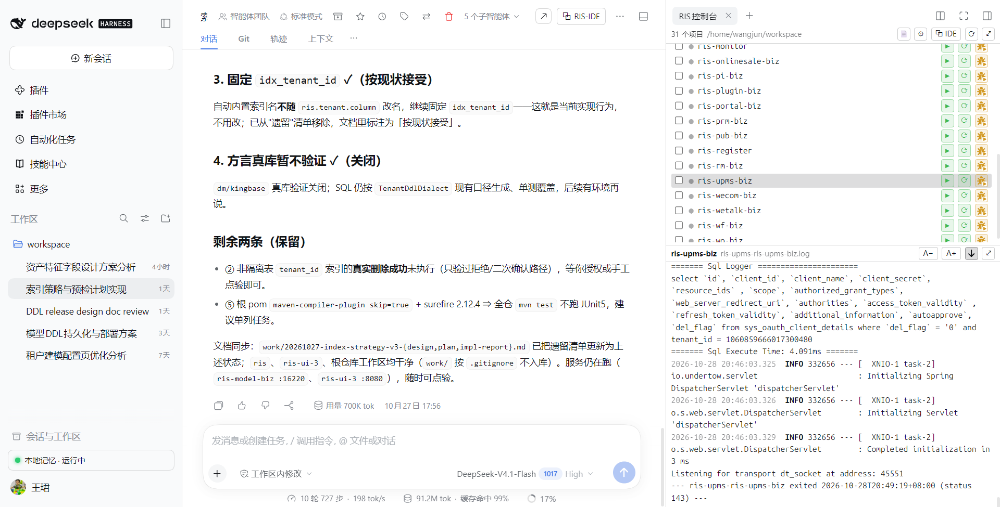
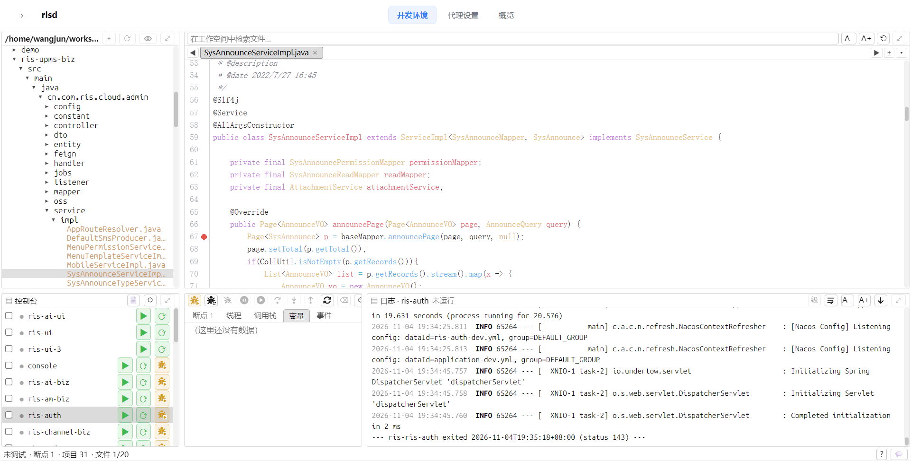

# dsh-ris-ide

**RIS-IDE local dev panel for the DSH (DeepSeek Harness) web GUI** — tail your service logs, start/stop workspace programs, debug Java with JDWP, browse and edit files, all without leaving the chat window. A standalone IDE window carries no session history, so it can stay open all day.

DSH（DeepSeek Harness）Web GUI 右侧栏里的 **RIS-IDE 本地开发面板**：不用离开聊天界面，就能看服务日志、启停本地程序；文件树 / 编辑器 / Java 断点调试在**独立窗口**里（侧栏只放控制台 + 实时日志，保持轻量）。

> 面向开发者/维护者的文档（架构、路由、命令、配置字段、里程碑、打包/发布/Jenkins、测试与踩坑）见 [DEVELOPMENT.md](https://gitee.com/riscloud/dsh-ris-ide/blob/master/DEVELOPMENT.md)。

## 轻量级 IDE

这不是又一个桌面 IDE，也不打算替代 IDEA / VS Code——它要解决的是「看一眼、改一下、跑一下、断一下」这类碎片化操作必须切窗口的问题：

- **按需加载，不常驻重资源**：编辑能力来自独立懒加载的 CodeMirror chunk（约 1.1MB，**第一次打开文件时才拉取**）；不起 language server、不做全库索引、没有后台守护进程、不新开端口，只复用 DSH 已有的 `/dsh-ris-ide/*` 路由和**一条 SSE**。
- **面板本身很轻**：侧栏只留「RIS控制台」（控制台 + 实时日志，默认 240px）；完整工作台放在**独立窗口**，该窗口不加载 DSH 界面、不带会话历史（插件主客户端约 680KB + DSH 的 React + 一条 SSE；编辑器能力是另外按需拉的 1.1MB chunk），开一整天也不会随会话历史变重。
- **日常闭环够用**：git 口径文件树与**文件名 + 文件内容**搜索（内容检索走 `git grep`、无索引；标题栏眼睛可临时关闭 .gitignore 过滤）、编辑/保存/多页签（含与磁盘的逐行 `±` 对比、Java 单测一键 `▶` 运行）、Markdown/HTML 内联预览（编辑/预览一键切换，开关悬浮在编辑区右上角、不占行高，不依赖侧栏服务）、目录变更自动跟随、日志实时跟随与着色（点启动立刻切到该程序日志，编译静默期有提示；可按级别 `W+`/`E+` 过滤）、程序启停/**重启**/**批量启停**、Java JDWP 断点调试，以及给 agent 的 `ris_dev_*`——都在同一处完成。
- **与重型 IDE 互补**：大重构、全局索引、深度语言服务仍交给 IDEA；这里负责顺手改一行、跑一下、看日志、和 agent 协作时共用同一个面板。

| 侧栏「RIS控制台」：控制台 + 实时日志|
|---|
|  |

| 独立窗口（普通浏览器窗口、无会话历史；控制台标题栏有 📄/⚙）|
|---|
|  |

## 功能

- **程序控制台**：扫描工作区的 Spring Boot 入口、前端 `package.json` 脚本与有 pidfile 的历史实例；每行 `▶ 启动 / ■ 停止 / ⟳ 重启 / 🐞 调试 / ▤ 日志`，启停期间行上有遮罩（文案按动作）。勾选 2 行以上时标题栏出现 **▶ 批量启动 / ■ 批量停止 / 清除**（按列表顺序启动、倒序停止、跳过无需动作的，按钮上显示 `i/N`）。点程序行（名称或整行）下方日志立刻跟随该程序。
- **日志**：走一条共享 SSE 实时增量；ANSI/级别着色，默认**只看本次启动**（更早内容向上滚动仍可加载）；标题栏 `级 → W+ → E+` 级别过滤、换行开关（真正的 `pre-wrap`/`pre`）、`A−/A+` 字号、跟随/暂停、`Ctrl+F` 查找条、内容溢出时**滚动条常驻可见**；标题栏显示 `运行中 (pid N)` 并可一键**停止服务**（pidfile + `/proc` 校验后才发信号）。
- **文件树**：git 口径（`.gitignore` 过滤，标题栏眼睛可临时关闭；没有 git 也能用）；新建/新建包名/重命名/复制/移动/删除/从系统导入（复制/剪切同时把文件列表写进**系统剪贴板**，可直接粘贴到资源管理器/桌面：WSL 走 PowerShell，Linux 走 xclip/wl-copy，macOS 走 JXA）；**Ctrl+点击多选**、`Ctrl+A` 全选、批量复制/剪切/粘贴/拖动/删除（重名自动「 副本」「 副本(n)」，成功提示带「撤销」，一条批量操作只占一次撤销）；点文件夹行 = 展开/折叠，换根走右键菜单「**进入**」（行首出现 `↑ 上级` 逐级返回）；「新建文件 ▸」hover 在右侧弹出类型面板；新建/重命名/粘贴为/删除确认等弹窗**锚定在鼠标旁**；工作区变更经同一条 SSE **静默**自动刷新，只有标题栏 ⟳ 点击才提示结果。
- **检索**：同一个框搜**文件名 + 文件内容**（内容走宿主 `git grep -n`、无索引、上限 200 条）；两类结果排在一起，首屏 40 行、滚到近底再追加 60 行（末尾提示剩余行数），`↑/↓` + `Enter` 打开；默认指向文件名完全匹配的那行、否则第一行；选中后检索词与结果**保留**，快捷键聚焦时**全选**框内文字；内容命中会把检索词带进编辑器查找框并定位到命中行。
- **编辑器**：按需加载的 CodeMirror（Java 等语法高亮）、多页签（切换时页签自动滚入可视区）、保存/脏标记、`Ctrl+D` 删行、自绘**两行式查找/替换面板**（查找一行、替换一行，等宽输入框 + 图标按钮 + 匹配计数 + `Aa`/`.*`/`ab` + `↑/↓`/替换/全部替换）；**点选区或搜索命中块当次就把光标放进去**；失焦不残留全选色；有未保存页签时关闭页签/刷新页面先确认；`±` 打开与磁盘版本的逐行对比（仅在有未保存修改时可用）；`src/test/java/**/*Test.java` 标题栏出现 **▶ 运行测试**（`mvn -pl <module> test -Dtest=<类>`，输出保留开头 4K + 省略 + 结尾 400K，状态 通过/失败/超时，可重跑）。
- **预览**：`.md/.markdown/.html/.htm` 编辑/预览切换按钮**悬浮在编辑区右上角**（不占代码行高，预览含未保存修改）；超过整读上限的大文本以**只读分页预览**打开（滚到近底取下一页、内存超限释放前文、滚动位置按文件记住），标题栏「编辑」可强制全量加载进编辑（上限 32MB）。
- **JDWP 调试（仅 Java）**：点行号加断点、双击红点删除（空行/注释行忽略）；断点/线程/调用栈/变量/单步/继续；对象与数组懒加载展开、继承字段与空值也列出；依赖 jar 自动取 `-sources.jar`，没有则 `javap` 反汇编，也可在调试面板 ⚙ 填反编译 jar（如 CFR），缓存按 jar 指纹失效并有 64MB/30 天上限回收；命中后自动切「参数」页签、打开源码并高亮当前行；前端程序只能启停/看日志。
- **独立窗口**：聊天页右上角 **⧉ RIS-IDE**（或控制台标题栏 ⧉）打开，**填满屏幕**、**不加载 DSH 界面/不带会话历史**，与侧栏同一套 `/dsh-ris-ide/*` 路由与 cookie，没有新端口；窗口按**工作空间**单例，从程序目录调试也不会开出第二个。
- **代理**：规则表是全机一份文件（`~/.dsh-ris-ide/proxy.json`），所以入口是 CLI/工具与 **risd 维护页**——`node <dsh-ris-ide>/lib/proxy.js rules` 看表、`… start` / `… stop` 管引擎，`yds proxy sync` 从 confcenter 自动生成该项目的规则（DB/Redis/gitlab/回调网段）。**插件面板不再内置代理配置界面**（1.8.0 起，D4）：risd 维护页的「代理设置」页签（`http://127.0.0.1:11082/ui?tab=proxy`）不依赖 dsh，直接编辑全机规则表。系统层拦截需要的 **ProxyBridge 组件改为首次使用时下载**（不再随包内置 2.9 MB 二进制）：risd 维护页「代理 → 组件」一点即下——内置 **Gitee 主地址、GitHub 备用**两个镜像（同一份发版附件，前一个失败自动换下一个），也可上传 `ris-proxy.4.0.tgz`，或设 `DSH_RIS_IDE_PROXYBRIDGE_URL` / `settings.json` 的 `proxybridgeUrl` 走内网镜像；装进 `~/.dsh-ris-ide/proxybridge/bundle/` 后复用，安装完成后面板只显示「已安装」。下载失败时面板给出两个下载地址与手动上传入口。许可文本（MIT + WinDivert LGPL-3.0）随包安装。组件包按**固定 sha256** 校验（下载与上传都验内容；`DSH_RIS_IDE_PROXYBRIDGE_SHA256` 或 `settings.json` 的 `proxybridgeSha256` 可覆盖，置空=首次信任；重发附件改了内容要同步更新常量并发版）；已安装后在面板里可「重新下载」（强制刷新缓存副本）。未安装时会明确提示入口而不是静默失败；机器上已装的 ProxyBridge / `DSH_RIS_IDE_PROXYBRIDGE` 仍是回退。WSL 下先把 Windows 版复制到 `%LOCALAPPDATA%\dsh-ris-ide\proxybridge\windows` 再启动。**一个 启动/停止 管全部三层**——本地引擎（给本插件 spawn 的程序注入代理）、系统层拦截（ProxyBridge 按进程名在系统层改路，覆盖 Navicat、IDE 里的 java、终端 git）、git 配置（`git config --global http.https://<host>/.proxy = socks5h://…`，写完终端里的 `git` 与 dsh-git 都走隧道）；`dsh` 退出时三层一起停，不留残留。**全机一份规则表**（`~/.dsh-ris-ide/proxy.json`，`DSH_RIS_IDE_PROXY_HOME` 可改位置），整机生效、不区分工作区与会话，行尾「来源」列只记是用户行还是 yds 注入（`yds·win` / `yds·wsl` 还会标出命中的一侧）。提权是正常流程：Windows 侧启动时弹 UAC，Linux 侧需要免密 sudo；提不到权时弹窗里给出可直接粘贴的命令。Windows 侧启动还有三个实测过的细节：GUI 安装的服务 `ProxyBridgeSvc` 与 CLI 互斥（都抢 WinDivert 句柄），所以先停服务再起 CLI（停过会记下来，停止时尝试恢复）；手起或遗留的 `ProxyBridge_CLI.exe` 先结束再接管；CLI 没有日志开关，stdout 重定向到 `%TEMP%\dsh-ris-proxybridge.log`，起不来时日志尾部就是错误原因。两层兜底：ProxyBridge 没在跑时，支持代理的程序（java / git / node / curl）启动时注入**本机 CONNECT 代理** `http://127.0.0.1:11081`（`ALL_PROXY`/`HTTP(S)_PROXY` + JVM 的 `-Dhttp(s).proxyHost/Port`），每一条连接仍然要过规则里的 IP/端口白名单——注入不再等于「把上游 SOCKS 地址直接发给程序」。想让某个程序完全绕过白名单、直连上游 SOCKS，就在该行加 `"direct": true`（`proxy.json` 里的行级开关，界面暂无控件）；不支持代理的客户端（Navicat / JDBC）自动映射 `127.0.0.1:同端口`——这些映射行是实现细节，不进界面。维护页「代理设置」页签上部填上游 SOCKS（host/port）与本地 CONNECT 端口，下部是规则表：`启用 · 程序名称/路径 · 目标主机 · 端口 · 状态 · 来源`（程序列写裸名按镜像名匹配、写路径精确到那个可执行文件；目标主机可用 `172.20.*` 这类通配，端口可写 `1521`、`1000-1010` 或 `*`）。**全机一张表、改动直接覆盖**：没有「读取 / 保存」按钮，也没有按工作区区分——改动 700 ms 后自动校验并写表（缺程序/IP/端口或端口格式不对只提示、不写），写进去的就是整张表，未出现的行会被删掉（这也意味着 `yds stop` 能靠「不发那些行」把注入的规则撤干净）；写盘后先停旧的系统层拦截再按新表重启，换拦截的两轮探测在后台跑，页面不会被它卡住。「状态」列直接回答这行现在生效没（未启用 / 缺… / 端口格式 / 待启动 / 生效）。引擎与拦截只用一个按钮管：运行中显示「停止」，停止后变「启动」——如果系统层拦截是 root 起的，停止会如实告诉你「请用 sudo stop」并给出命令；启动还在等提权时点停止则提示「另一个进程正在启动桥接，请稍后再试」（未运行/运行中的另一状态不再另设按钮）；点下去到生效之间按钮显示「启动中…」/「停止中…」并暂时不可点（等提权或引擎拉起），不会看起来像没反应。`yds proxy sync` 注入的规则在 **Windows 与 WSL 两侧各一行**（`java.exe` / `java`、`git.exe` / `git`，「来源」列标 `yds·win` / `yds·wsl`）——ProxyBridge 按镜像名匹配，`java.exe` 匹配不到 WSL 里的 `java`，以前这里只注入 Windows 侧。ProxyBridge 该侧起不来（Linux 需要 root）时，同一行会给出可直接粘贴的 `sudo …/ProxyBridge --profile … --verbose 2`。卡片上的组件健康是**一行定时状态**（旁边还有「提权启动」：先试免密 `sudo`，做不到就**弹一个小窗口（居中）**让你在里面输密码，窗口开着的期间组件卡里会有一行提示、关掉就消失，密码输完窗口自动退出、拦截继续跑（日志在 `~/.dsh-ris-ide/proxybridge/elevate-<side>.log`）；两者都不行时才只显示命令）（每 10 秒复查：`拦截运行中` / `拦截未启动` / `组件异常` / `代理引擎未启动` / `组件不应运行`），没有「重新检查」按钮，也不列每侧文件数；组件安装好之后卡片只显示「已安装 · 文件 N 个」，不再给下载/上传按钮。那一行状态只在**代理引擎运行时**才检查（引擎没跑时组件没被使用，不判红），检查只读、不启动也不提权；点它下面的「说明」可展开细节——本侧需要的 sudo 命令（直接粘贴到终端执行），以及**降级方案**：JVM 程序用 `-Dhttp.proxyHost/Port` 等参数、能读环境变量的程序用 `ALL_PROXY=http://127.0.0.1:<监听端口>`、git 已经由 daemon 写好 `http.<host>.proxy`（没写时说明里给出 `git config --global …` 命令）；JDBC/Navicat 这类拿不到代理地址的程序只能靠系统层拦截。组件起得来就是系统层拦截、起不来自动走降级，不会把「提不到权」当成组件故障。一台机器只可能有一种「本侧」——原生 Linux 没有 Windows 侧、原生 Windows 没有 Linux 侧（只有 WSL 才两侧都有），所以卡片只列这台机器真有的侧，单侧环境不会因此报「组件异常」。**引擎与组件始终成对**（m12046/m12053/m12060）：引擎启动后组件没起就自动拉起（需要 UAC/免密 sudo 时给出原因），引擎停了而拦截还在跑就自动停掉；daemon 启动、健康轮询、启停动作和 15 s 一次的监管都会把两者拉回一致，提权失败按分钟节流，不会反复弹窗。程序列两种来源——**运行中的进程**（本侧 + Windows 侧，只列支持 SOCKS 的）或**固定程序**（文件浏览器选可执行文件，可在启动前配好；裸名按镜像名匹配，含路径则精确到那个可执行文件）。

- 弹窗**没有保存按钮**：改动在停手 700ms 后自动写盘；写的时候会过一遍校验——**新建但没填完整**的行不写入（底栏提示「N 条未填完整，未写入」），**已经在文件里**的行如果被改到一半，会连同新内容写成「停用」（提示「N 条改到一半，已置为停用」），不会留下旧内容假装生效，也不会让半截规则生效。写完本机引擎立刻生效、系统层拦截静默重启；「+ 添加规则」只追加一个空行，不会弹选择器盖住表格。
- 「选…」打开的两页签选择器：**运行中的程序**（本侧 + Windows 侧进程，只列支持 SOCKS 的）、**选择文件**；文件页签下面是**树**——点文件夹原地展开（只读被展开的那一层），点文件即选中，不再一级一级「进入目录」；顶层入口只有**根路径 `/`** 与 **Windows C:/D:**（WSL 下 `/mnt` 就是 Windows 盘，所以只有一个文件页签；在那里选中的路径会写成 `D:\…`）；**没有子项的文件夹**渲染成叶子（`·`、灰一点、点不动），不会出现按下去没反应的空展开。
- 初始只给 **java / git** 两行模板（node、curl 不再自动生成；要用就自己加一行）。

**规则什么时候真的生效**：一行必须同时满足 ①已启用 ②填了程序 ③填了 IP ④填了端口——四样都显式写出才算数，要「全匹配」就写 `*`（空白**不等于**全部，半成品行在表里会用红字标「不生效：缺 IP/缺端口」，也不会进 ProxyBridge profile 和本机允许列表）。

**这些路由的信任边界**：全部只应答 loopback 请求，`sessionId` 的作用是选工作区（日志/启动目录），**不是权限凭据**——能连本机 3080 的进程就能改这台机器的规则表（与 `ris_dev_*` 系列同一模型）。若以后要收紧，正确做法是把「会话登记过的 cwd」做成白名单，而不是相信客户端传来的 `sessionId`。
**改规则不用重启**：本机引擎（`127.0.0.1` 映射 / CONNECT 允许列表）监听 `proxy.json`，保存后原地换规则、不重启进程；系统层拦截（ProxyBridge）只在启动时读 profile，由已提权的看门狗静默重启它（约 2s、不弹 UAC、不动其它程序）。
- **给 agent 用**：内置 `ris_dev_*` 工具（列程序/状态/启动/重启/停止/读日志/调试/安装 skill），与面板共用同一套宿主命令。
- **跨平台**：Linux/macOS 用 bash 包装；Windows 自动选 Git Bash 或原生 PowerShell 包装，停止用 `taskkill /T` 杀整棵进程树。

## 相关插件：dsh-ris-yds（可选）

如果在做 **YonBIP / YMS** 相关开发，[`dsh-ris-yds`](https://gitee.com/riscloud/dsh-ris-yds) 与本插件互补，
提供这些辅助开发能力：

- 在本地运行 YMS 运行时，不必连远端环境；
- 访问内网数据库、缓存与内网服务；
- 准备本地开发配置，并可在「代理 / 直连」两种方式之间切换；
- 生成调用平台 API 的凭据，辅助前端调试。

- 两个插件**互不依赖**：各自都能单独安装、单独工作；装在一起时不会重复启动隧道。
- 工作区出现 YMS/YonBIP 工程特征时，`ris_dev_programs` 的返回里会附一句安装建议——只是推荐，不会调用它。

## 可选：risd 代理 daemon

代理引擎默认仍由插件进程托管（`Ctrl+C` 会一并停掉，与之前一致）。如果你希望代理生命周期不再绑在某个 dsh 窗口上（多开时关一个不影响其他人、窗口全部关闭后仍可按策略保留），可以打开 `daemonMode`：

- **默认开启**（`daemonMode=auto`，1.8.0 起；`daemonMode=off` 或 `DSH_RISD_MODE=off` 是一词回滚）。插件挂载时会确保 `risd` 在跑（`127.0.0.1:11082`，随机 token，状态在 `~/.dsh-ris-ide/risd.json`），并登记一个租约（owner pid + 心跳，3s 探活）。
- daemon 接管**引擎**：启动/停止代理、写规则、git 代理、系统层拦截的 reload 都经它串行执行；插件只负责转发。最后一个租约消失后，daemon 按 `session` 策略依次撤销 git → 拦截 → 引擎；随后空闲 10 分钟自动退出，下次需要时再被拉起。
- daemon 还负责写桥接心跳（不再由 dsh 进程写）并独占 janitor；升级 daemon 时用 `POST /v1/shutdown {handoff:true}` 交接，新 daemon 直接收养既有引擎（pid 不变，隧道不断）。
- daemon 还托管**程序与 JDWP**：`ris_dev_programs/start/stop/logs/debug` 在 `daemonMode=auto` 时优先问 daemon（失败自动回退本地，`ris_dev_status` 仍读本地 pidfile/日志），所以刷新页面不会丢调试会话；dsh 全部关掉后打开 `http://127.0.0.1:11082/ui` 就能启停程序、看日志、断开调试会话、重启桥接。维护页顶部居中三个页签（顺序 **开发环境 · 代理设置 · 概览**；刷新或快捷键重载后回到上次的页签与工作区，dsh 的 ⧉ 只切换工作区、不抢你正在用的页签）：**概览**（守护进程状态、代理运行状态、按工作区分组的运行中程序、调试中的进程，都可停止）、**代理设置**（不依赖 dsh 的**全局**规则编辑器：规则按机器生效、不区分工作区；SOCKS/监听端口/规则行增删改**即自动保存**——700 ms 防抖 + 行校验（**保存只写表，不会启动引擎**：引擎由「启动」按钮或生命周期「代理引擎跟随 dsh」启动），CAS 冲突静默换 revision 重写一次；组件区只有一个「启动/重启系统层拦截（可能提权）」按钮，只在缺拦截或重载失败时出现，鼠标悬停会说明原因）、**开发环境**（整页无留白地嵌入 dsh 的 IDE；左侧是**默认收起**的工作区面板，点 header 左侧的 `‹`/`›` 展开或收起并记住选择；按 **dsh 工作区标题**显示（改名即时生效，路径作身份）、列表镜像 dsh 侧栏的全部工作区，点击即切换；5 分钟没动静的工作区标「未活跃」但仍可点，选中时上方提示该窗口可能已关闭；在 iframe 外任意处点击都会把光标送回 IDE；dsh 不在时该页签自动置灰并显示原因）。
- **改完不用强刷**：插件把当前 client bundle 的指纹随 SSE `hello` 下发（另有 `GET /dsh-ris-ide/build`），并每 30s 复查一次；发现代码变了只在右下角提示「IDE 界面已更新：刷新页面后生效」（**不自动 reload，避免丢掉未保存的编辑与会话视图**，点提示再刷新）。维护页 `/ui` 同理：daemon 重启成新代码、或源码比进程新、或 token 因 daemon 重启失效，都在顶部显示横幅；**「插件版本已更新」这条点按钮就是「重启并刷新」**——daemon 先交接重启（保留正在跑的代理引擎/桥接），新进程起来后本页自动重新加载，不用自己去命令行重启。**开发环境里有未保存文件时横幅会多一个「保存所有文件」按钮**——点它先把内嵌 IDE 的脏 buffer 全部保存再整页刷新（不会悄悄丢掉编辑）；没有未保存内容时直接自动刷新，刷新后回到原来的页签与工作区。代理规则未保存时也会先确认。Node 在启动时 import 的模块不会再读盘，这不是浏览器缓存，强刷也没用。
- **保存即换新**：保存规则时先把上一份表应用过的机器级副作用收回（git 条目按新表切 host 或清掉；系统层拦截若重载失败就直接停止，而不是留着旧规则继续拦截），再应用新表。若提示「旧规则可能仍在生效 / 需要提权」，提示旁有 **提权重启** 按钮：点一下即「停止 → 重载 → 启动」（Windows 弹一次 UAC；本侧 root 桥接需要 sudo，命令会显示在提示里）。
- daemon 不可达时视图与会话内动作自动回退到插件本地执行，维护页打不开时可以用 CLI；**`daemonMode=off` 即完全回到旧行为**，此时点 ⧉ 不会拉起 daemon（两个 owner 会抢同一个引擎与 janitor），而是直接打开独立 IDE 窗口。
- **入口**：dsh 顶部 ⧉ 和面板控制台的 ⧉ 都打开 **risd 维护页**（面板里不再有代理按钮：规则编辑只在这个页面），并且自动选中当前工作区（页签保持你上次的选择）；**daemon 已停止或意外退出时，点 ⧉ 会先自动把它拉起**（点一次即可，失败才回退到独立窗口）。维护页「概览 → 守护进程」一行可看状态并停止 daemon；停止会同时停掉它托管的程序、调试会话和代理，页面会先弹确认列出将停止的内容。**概览底部还有「生命周期」设置**：守护进程 / 代理引擎 / 程序 / 调试会话各自可以选择是否「跟随 dsh」（最后一个 dsh 窗口退出后停）。**「跟随 daemon」是强制的**：停止 daemon 时它托管的程序、调试会话与代理一定一起停，不提供关闭项。默认是代理跟随 dsh、程序与调试不跟随 dsh，配置存在 `~/.dsh-ris-ide/risd-lifecycle.json`，**勾选即保存并生效**（没有保存按钮）、不用重启。
- 手动体验（`risd` 命令由本包的 `bin` 暴露；`npm link` 或把 `bin/risd.mjs` 软链进 PATH 即可）：`risd serve`、`risd status`、`risd health`、`risd stop`、`risd version`；日志 `~/.dsh-ris-ide/risd.log`。

已知边界：本侧（WSL/Linux root 起的）系统层拦截仍不支持热重载（要重启）；规则表的 `shadow` 端口没有内置默认值，全部来自配置与 dsh-ris-yds 的写入。

- **开发环境的「工作区」状态互相独立**：打开的文件页签、当前文件、最近文件、检索结果缓存都按工作区（`cwd`）各存一份——切换工作区不会把上一个仓库的页签或 `git grep` 结果带过来。

## 安装

需要 DSH `>= 0.2.0-rc.2`，且 Web GUI 带官方右侧栏服务（`sidebarRight` / `sidebarRightTabs` / `slots`）。

**本插件自身不依赖任何外部资源**：零运行时 npm 依赖、客户端产物（含 CodeMirror）已随包发布、不起独立端口，只使用 DSH 自带路由与 Node 内置模块。唯一的联网动作是用户在维护页触发的 **ProxyBridge 组件下载**（系统层拦截首次启用时；可换成内网/本地上传源），除此之外不联网。本机工具只在特定能力上需要：`git`（有则按 gitignore 过滤文件树/搜索；**没有 git 也能用**，退化为不过滤）、JDK `java`/`javap`（启动/调试 Java 程序、反汇编依赖类）、Maven（默认起 Spring 服务时会 `mvn compile`，本地仓库没缓存时会联网下载依赖）、Node/前端包管理器（启动前端 dev server）。

发布到 npmjs 后：

```bash
dsh plugin --profile web add dsh-ris-ide
```

在**内网环境**里，把 registry 指向公司内部的 npm 源（地址见内部运维文档，不在此仓库公开），装完同样是上面这条命令：

```bash
# 例：临时 .npmrc 只写 registry，退出/失败自动删除
P=~/.dsh/profiles/web; ( printf 'registry=<internal-registry>\n' > "$P/.npmrc"; trap 'rm -f "$P/.npmrc"' EXIT; dsh plugin --profile web add dsh-ris-ide )
```

离线 / 内网机器也可以直接装 tgz：

```bash
dsh plugin --profile web add /path/to/dsh-ris-ide-<version>.tgz
```

说明：

- `dsh plugin add` 会写 `~/.dsh`（沙箱会话里需要提权）；它会把插件加入 profile 的 `dependencies` 与 `bundles`。
- 装完**重启 `dsh web`**（Loader 在启动时组合一次），浏览器再**硬刷新**（Ctrl+Shift+R）加载新的客户端 bundle。
- **升级**：先删掉 profile 里旧副本再装，否则 pnpm 可能因 `Lockfile is up to date` 跳过：
  `rm -rf ~/.dsh/profiles/web/node_modules/dsh-ris-ide`，然后重跑上面的安装命令（换成新版本号）。

## 使用

1. 打开 DSH Web GUI，右侧栏进入「**RIS控制台**」标签（完整工作台可从聊天页右上角 **⧉ RIS-IDE** 按钮在独立窗口打开，见下）。
2. 首次打开会在工作区根生成 `.dsh-ris-ide/config.json`（扫描生成；之后按它启动，可在面板里改配置后更新），生成完成后会提示文件位置。`.dsh-ris-ide/` 是插件在工作区里的**唯一**隐藏目录：配置 `config.json`、调试设置 `settings.json`、删除回收 `trash/`、源码缓存 `cache/`、复制暂存 `stage/`。
3. 程序行上的控件（侧栏「RIS控制台」与独立工作台的控制台同一套行语义）：
   - **▶ 启动 / ■ 停止**：启动后日志自动可看；停止按 pidfile 校验后 TERM → 宽限 → KILL，连进程组一起收掉。
   - **🐞 调试**：仅 Spring/Java 程序，点击直接在独立窗口里以 JDWP 模式重启并 attach（含断点 / 线程 / 调用栈 / 变量 / 事件）。
   - **⟳ 重启**：改完代码后的日常动作——运行中的先停（释放 pidfile）再按原参数起，已停止的就是启动；两种状态下按钮都在（`POST /start` 带 `restart:true`）。
   - **批量启停**：每行左侧有复选框，勾上 2 行以上时标题栏出现「已勾选 N 项」+ **▶ / ■ / 清除**——按列表顺序启动、倒序停止，自动跳过已在运行/已停止的，按钮上显示 `i/N` 进度。
   - **点程序名或整行**：下面的日志区立刻跟随该程序的实时日志。
   - 行上没有「进入」按钮：完整工作台用面板顶栏 **⧉ IDE**（或聊天页右上角 **⧉ RIS-IDE**）打开——上调试区，下实时日志，右侧文件树与编辑器。
4. 日志：直接在工作台或日志页查看；`Ctrl+F` 打开日志内查找，标题栏按钮按 `级 → W+ → E+` 过滤级别（WARN/ERROR 的缩进续行保留）。agent 说“看日志”时等效于 `ris_dev_logs`，会把日志弹到这个面板。
5. 调试（Java）：先看状态（`ris_dev_debug state`）→ 启动调试（`start`）→ 加断点（类名 + 行号）→ 线程/栈/变量/单步。自定义 `startCommand` 必须在 `java` 后带 **`${JDWP_ARGS}`** 占位符，否则调试启动会直接报错。

## 配置

配置写在**工作区根**的 `.dsh-ris-ide/config.json`（面板自动生成/校验/更新，也可以手改；老版本放在工作区根的 `.dsh-ris-ide.json` 会在首次打开时自动搬进去）：

| 字段 | 作用 |
|---|---|
| `defaults.jvmArgs` | 所有程序的默认 JVM 参数（如 `["-Xmx2g"]`） |
| 程序条目 `jvmArgs` / `args` / `env` | 该程序的 JVM 参数 / 应用参数 / 环境变量（`jvmArgs` 覆盖 `defaults`） |
| `startCommand` | 覆盖自动拼装的启动命令（自定义启动方式；含调试占位符 `${JDWP_ARGS}`） |
| `logName` / `stopGraceMs` / `disabled` | 日志文件名 / 停止宽限（默认 5000 ms） / 是否跳过该程序 |

字段的完整语义、扫描规则与冲突处理见 [DEVELOPMENT.md](https://gitee.com/riscloud/dsh-ris-ide/blob/master/DEVELOPMENT.md) §2.6。

## 权限与安全

能力边界（插件**只在以你身份运行的本地 DSH 里**工作）：

- **启动/停止进程**：按工作区扫描结果执行 Maven / npm 启动命令，停止时按 pidfile 校验后杀整个进程组；不监听公网端口、不做远程控制。
- **文件读写**：宿主路由只服务 loopback 请求；路径按会话 `cwd` 解析（默认不强制包含性限制，除非配置 `restrictToCwd: true`）；写入走 `/dsh-ris-ide/fs/write`。
- **环境变量与日志**：读取运行时 `PATH`/`HOME` 等以拼装启动命令，日志只读工作区内 `.log` 文件。
- **无遥测**：不向外发送任何请求（除浏览器从本机 DSH 宿主拉 `/dsh-ris-ide/*` 与 SSE）。
- 所有 HTTP 路由都拒绝非 loopback Host/Origin，避免被本机其它网页借用。

## Windows

已支持：启动包装自动选择 **Git Bash**（有则用同款 `run-with-log.sh`）或原生 **PowerShell**（`run-with-log.ps1`，零依赖），停止用 `taskkill /T` 杀整棵进程树。WSL bash 不支持，需要时用 `startCommand` 包 `wsl.exe`。细节见 [DEVELOPMENT.md](https://gitee.com/riscloud/dsh-ris-ide/blob/master/DEVELOPMENT.md) §1.5。

## 卸载

```bash
dsh plugin --profile web remove dsh-ris-ide   # 同时移除 bundles 条目
```

然后重启 `dsh web`。

## 源码与镜像

- Gitee（主仓库）：<https://gitee.com/riscloud/dsh-ris-ide>
- GitHub（只读镜像，每 2 小时从 Gitee 自动同步）：<https://github.com/ris-cloud/dsh-ris-ide>——请勿在 GitHub 侧提交，会被下一次同步覆盖。
- npm 包的 `repository` 字段指向 GitHub 镜像：npm 的 OIDC 可信发布会自动生成 provenance，要求 `repository` 与构建所在的 GitHub 仓库一致；源码仍以 Gitee 为准（`homepage`/`bugs` 与本文档均指向 Gitee）。

## 开发

打包与发布、路由与内部实现、测试、里程碑与踩坑都在 **[DEVELOPMENT.md](https://gitee.com/riscloud/dsh-ris-ide/blob/master/DEVELOPMENT.md)**；上架规则与提交步骤在**仓库外**的插件开发手册里——本仓库只放符合规范的配置与 `npm run check:listing` 自检。
